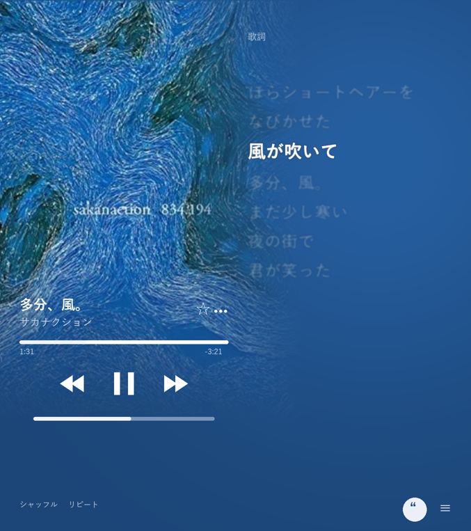
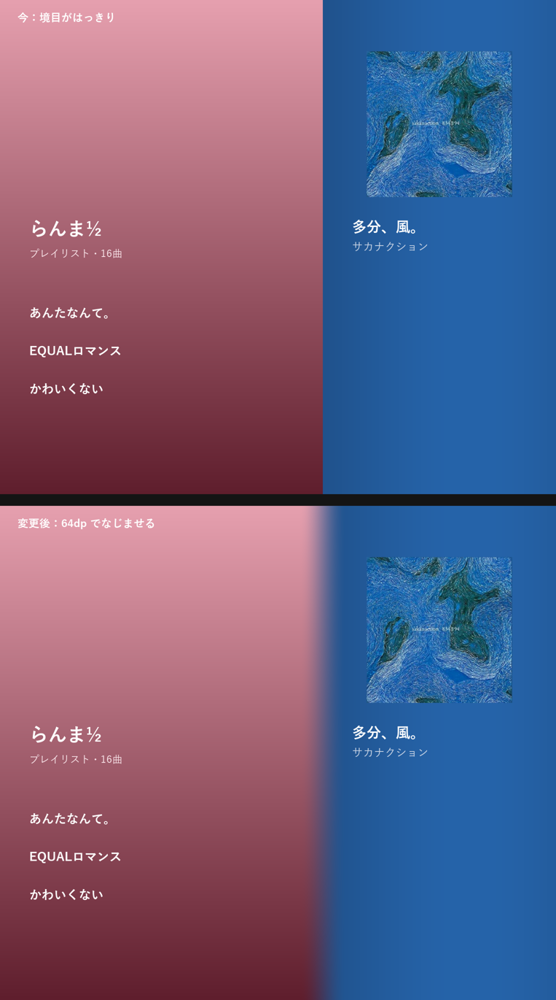

# 折りたたみを開いたときの再生画面・横向きの境目・「多分、風。」の頭 — Implementation plan

## 要望
1. 折りたたみスマホを開いたときの再生画面を、参考画像 1 枚目のようにする。左右非対称の 2 カラム。境界線は引かず、背景のグラデーションで、左の「アートと操作」と右の「歌詞」をなめらかにつなぐ。
2. 90 度回したとき(今は画像 2 のように、左にページ・右に再生画面)、境目がはっきりしすぎているので、なめらかにつなぐ。
3. 「多分、風。」など、曲の頭がフェードインするように聞こえる。

---

## 端末の画面の大きさ(Vivo V2337A で確認)
| | 大きさ | 今の表示 |
|---|---|---|
| 閉じた状態(外の画面) | 361 × 846 dp | 普通のスマホの再生画面 |
| 開いた状態 | 677 × 763 dp(ほぼ正方形) | 再生画面が全画面。スマホの再生画面を中央に置いただけ(最大 560dp 幅) |
| 開いて 90 度回した状態 | 763 × 677 dp | 左にページ、右に再生画面(幅 320dp)。境目がはっきり |

- 幅 700dp 以上で「ページ + 横に再生画面」になる。開いた状態は 677dp なので、再生画面が全画面になる。

---

## Ch1. 開いた状態の 2 カラムの再生画面

### レイアウト
- **左の列(画面の約 52%)**: アートと操作。
  - アートは左上の角から画面の高さの約 8 割まで、左の列いっぱいに大きく敷く。
  - アートは右側と下側に向かって、背景の色へ溶けるように消えていく(グラデーションのマスク)。右側は歌詞の列へ、下側は操作へつながる。
  - アートの消えかけたところに、曲名・アーティスト・お気に入り・三点ボタン。その下に再生バー、曲送りなどのボタン、音量。
- **右の列**: 歌詞。今の行がはっきり、ほかの行は薄くぼかして表示(今の再生画面の歌詞と同じ表示・同じ動き。行を押すとその位置へ)。
- **背景**: 今の再生画面と同じ、アートの色のグラデーション(メッシュ)を画面全体に 1 枚。左右で色が切れない。境界線は引かない。
- **下の列**: 左にシャッフル・リピートなど(今の下の列のボタン)、右下に歌詞とキューの切り替え。
- 再生画面を下に引いて閉じる操作・ミニプレーヤーとのつながりは、今のまま。

### 決めてほしいこと
- **AT: どの大きさから 2 カラムにするか**
  - **推奨: 再生画面が全画面で、幅 600dp 以上かつ高さ 600dp 以上のとき。** 開いた状態(677 × 763)はこれに入る。タブレットも同じ表示になる。閉じた状態・普通のスマホは今のまま。
  - 代替: 折りたたみ端末を開いたときだけ(画面の折れ目の情報で判断)。
- **AU: 歌詞がない曲のとき、右の列に何を出すか**
  - **推奨: キュー(次に流れる曲)を出す。** 右下のボタンで、歌詞とキューを切り替えられる。歌詞があってもキューに切り替えられる。
  - 代替 1: 「歌詞はありません」とだけ出し、アートを右まで大きく広げる。
  - 代替 2: 歌詞がない曲では 1 カラム(今の表示)に戻す。
- **AV: 2 カラムのとき、左の列のアートの見せ方**
  - **推奨: 参考画像のように、左の列いっぱいに大きく敷き、右と下へ溶かす。**(アートが正方形でないところは、上下か左右を切って埋める)
  - 代替: 今のように角の丸い正方形で置き、その周りだけを背景に溶かす(アート全体が見える)。

---

## Ch2. 90 度回したときの境目

### 今の作り
- 左のページと右の再生画面は、それぞれ自分の背景を自分の幅いっぱいに塗っている。間にすき間も線もないが、色がそこで急に切り替わるので、線があるように見える。

### 変更
- 再生画面の背景の左の端を、透明から少しずつ濃くなるようにし、ページの背景の上に重ねる(なじませる幅を決める)。ページの背景は、再生画面の下にも少し伸ばしておき、透けたところに見えるようにする。
- ページの文字や画像は、なじませる部分に入らないよう、右の余白を少し広げる(重なって読みにくくならないように)。
- 再生画面のアートやボタンの位置は変えない。

### 決めてほしいこと
- **AW: なじませる幅**
  - **推奨: 96dp。** モックの 64dp だと、ピンクと青のように色が離れているとき、途中が灰色っぽい帯に見えやすい。広いほど自然になる。
  - 代替: 64dp / 128dp。
- 色の混ぜ方は、途中で灰色にくすまないよう、明るさと色味を分けて混ぜる(実装の工夫。見た目は「なめらかに色が移る」)。

---

## Ch3. 「多分、風。」の頭がフェードインする

### 調べて分かったこと
- 「多分、風。」は、端末の中のファイル(SpotiFLAC で保存した m4a、中身は Opus という形式)。
- 再生を始めると、0.13 秒で音が出始め、再生位置も 0 から普通に進む。**頭が飛ばされてはいない。**
- アプリが音量を変えるのはクロスフェードのときだけで、今は 0 秒(オフ)なので動いていない。無音のスキップもオフ。音質の差し替えはファイルの曲には起きない。
- ファイルの中の設定(Opus の頭の飛ばし幅 312 サンプル = 約 6.5ms、再生開始位置 0)にもおかしなところはない。

### 残る候補
| 候補 | 確かめ方 |
|---|---|
| A. 音源そのものが、もともとフェードインしている | 同じファイルを、別のアプリ(端末の標準の音楽アプリなど)で再生して、同じように聞こえるか |
| B. この端末の Opus のデコーダーの出だしの扱い | 別のアプリで普通に聞こえ、Tinque でだけフェードインするなら、こちら |

### 進め方
1. **確かめてほしいこと:** 「多分、風。」を、Tinque 以外のアプリで頭から再生して、同じようにフェードインして聞こえるか。
2. 別のアプリでも同じなら、音源の問題なので、アプリでは直さない。
3. Tinque でだけなら、Opus の曲の頭のデコードを調べて直す(別のデコーダーを使う、曲の頭の処理を変えるなど)。そのときは、ほかの Opus の曲(YouTube Music の曲も Opus)でも同じか合わせて確かめる。

---

## 決めてほしいことのまとめ
| # | 論点 | 推奨 | 代替 |
|---|---|---|---|
| **AT** | どの大きさから 2 カラムにするか | **全画面で幅・高さとも 600dp 以上** | 折りたたみ端末を開いたときだけ |
| **AU** | 歌詞がない曲の右の列 | **キューを出す。右下のボタンで歌詞・キューを切り替え** | 「歌詞はありません」+ アートを広げる / 1 カラムに戻す |
| **AV** | 左の列のアートの見せ方 | **左の列いっぱいに敷き、右と下へ溶かす** | 角の丸い正方形のまま、周りだけ溶かす |
| **AW** | 横向きの境目をなじませる幅 | **96dp** | 64dp / 128dp |

---

## 対象ファイル(見込み)
| ファイル | 内容 |
|---|---|
| `ui/player/NowPlayingScreen.kt` | 2 カラムの判定と配置。アートのマスク。右の列の歌詞・キュー |
| `MainActivity.kt` | 横向きのページと再生画面の重なり・なじませ |
| `ui/player/` の背景(メッシュ)まわり | 背景を画面全体に 1 枚で敷く |
| (Ch3 で B のとき)`playback/PlaybackService.kt` ほか | Opus の頭のデコード |

## 確認方法(Vivo)
- 開いた状態で再生画面を開き、左にアートと操作、右に歌詞が出ること。アートが右と下へ溶けていて、線が見えないこと。歌詞が今の行を追うこと。歌詞のない曲で右にキューが出ること。
- 閉じた状態・普通のスマホでは、今と同じ表示のままなこと。
- 開いて 90 度回し、ページと再生画面の境目に線が見えず、色がなめらかに移ること。ページの文字が境目にかからないこと。
- ビルドして `release_apk\<version>_<内容>\` に置く。
