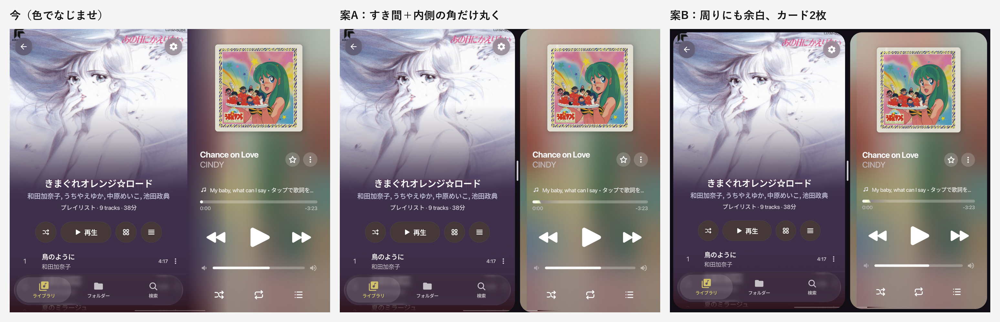
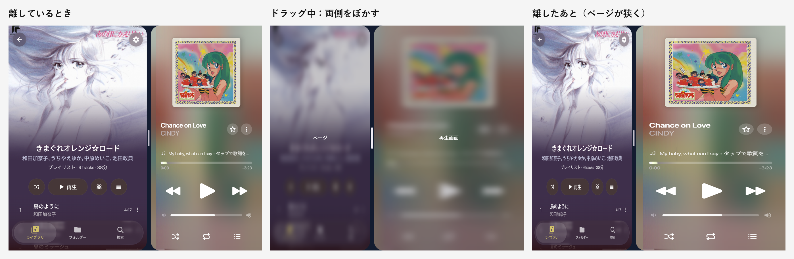
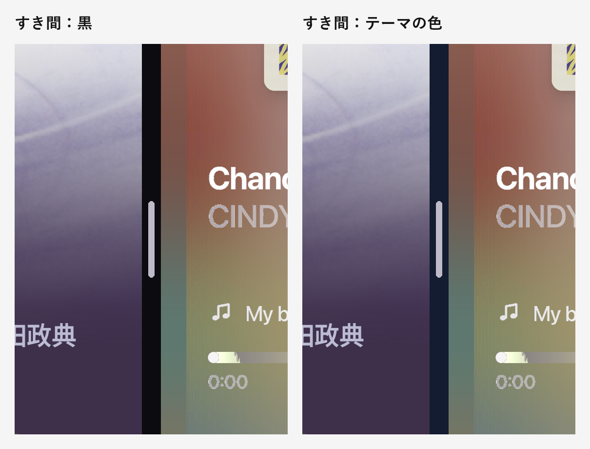
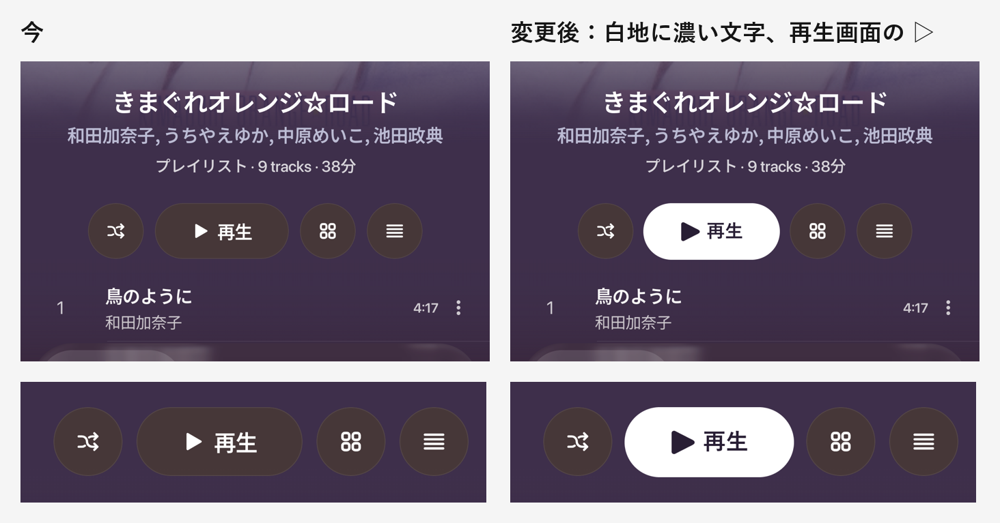

# 大きい画面の表示の選び方・ページと再生画面の仕切り・EQ の機器一覧・再生ボタン — Implementation plan

## 要望
1. Xiaomi Pad 6 で再生画面を開くと、縦でも横でも「左にページ、右に再生画面」になってしまう。直したい。あわせて、大きい画面で「2 カラムの再生画面」と「ページと並べる表示」を選べるようにしたい。
2. ページと再生画面の境目は、今の色でなじませる作りをやめて、Material 3 Expressive 風の仕切りにしたい。仕切りは左右にドラッグで動かせるようにし、動かしている間は両側をぼかす。
3. EQ の「どの機器につないだら、どのプリセット」の一覧に、Bluetooth で登録を消した機器が残り続ける。消せるようにしたい。
4. アルバム・フォルダーなどの「▷ 再生」ボタンを目立たせたい。背景と文字の色を逆にして、白地のボタンにする。▷ は再生画面の ▷ を使う。
5. アプリの中で、再生画面の ▷ 以外の ▷ を使っているところは、すべて再生画面の ▷ に置き換える。

---

## Ch1. 大きい画面での表示の選び方

### 今の作りと、Pad 6 で起きていること
- 今は「アプリの横幅が 700dp 以上なら、ページと再生画面を並べる」という決め方だけで、縦横の向きを見ていない。
- Pad 6 は縦にしても横幅が約 850dp あるので、縦でも並べる表示になる。
- 折りたたみを開いた状態は 677dp で 700dp に届かないので、2 カラムの再生画面になっていた(たまたま)。
- 公式の画面の大きさの分け方(Window Size Class。幅 600dp / 840dp で「スマホ / 中くらい / 大きい」)をそのまま使っても、幅だけで見る限り同じ問題が出る(Pad 6 の縦持ちは「大きい」、折りたたみの縦と横はどちらも「中くらい」)。

### 変更
- **縦横の形を主役にする。** 数字は、スマホかどうかの境目(600dp)と、並べるのに物理的に必要な幅(ページ 360dp + 再生画面 340dp = 700dp)の 2 つだけに減らす。
- 設定の「表示」に「大きい画面での再生画面」を足す。

| 設定 | 横長で 700dp 以上 | 縦長・正方形に近く、幅・高さとも 600dp 以上 | それ以外 |
|---|---|---|---|
| **自動(最初はこれ)** | ページと並べる | 2 カラムの再生画面 | スマホの表示 |
| 常に 2 カラムの再生画面 | 2 カラム | 2 カラム | スマホの表示 |
| 常にページと並べる | ページと並べる | 幅が 700dp あれば並べる。足りなければ 2 カラム | スマホの表示 |

- 「横長」は、アプリのウィンドウの幅が高さより大きいこと。
- 判定には、端末の画面ではなく、**アプリのウィンドウの実際の大きさ**を使う。今は幅だけ測っていて、2 カラムの判定の高さは端末の設定から読んでいるので、高さも測った値にそろえる。画面分割やウィンドウ表示でも、そのウィンドウに合った表示になる。
- スマホの画面(閉じた折りたたみ・普通のスマホ)では、この設定は表示しない。

### 端末ごとの表示(自動のとき)
| 端末・状態 | 大きさ(dp) | 表示 |
|---|---|---|
| Vivo 閉じた状態 | 361 × 846 | スマホの表示(今と同じ) |
| Vivo 開いて縦 | 677 × 763 | 2 カラム(今と同じ) |
| Vivo 開いて横 | 763 × 677 | ページと並べる(今と同じ) |
| Pad 6 縦 | 約 850 × 1350 | **2 カラム(直る)** |
| Pad 6 横 | 約 1350 × 850 | ページと並べる |
| タブレットで画面を半分に分割 | 例 約 400 × 850 | スマホの表示 |

### 縦に長いタブレットでの 2 カラム
- 今の作りでは、左の列のアートを画面の高さの約 8 割まで敷く。Pad 6 の縦持ちだと、幅約 440dp・高さ約 1080dp の細長い枠になり、アートが大きく切り取られる。
- **アートの高さは、左の列の幅の 1.2 倍までに抑える。** 余った高さは、操作の部分を下へずらして、上下のバランスをとる。

### 決めてほしいこと
- **AX: 設定の選択肢**
  - **推奨: 自動 / 常に 2 カラム / 常にページと並べる の 3 つ。**
  - 代替: 自動のみ(設定を出さない)。
- **AY: 600dp の境目の判定**
  - **推奨: Google の公式の部品(androidx.window の Window Size Class)で判定する。** 自前の数字が 1 つ減り、Google の境目が変わったときもそろう。部品を 1 つ足す(小さい)。
  - 代替: 今のように自前の 600dp の数字で判定する(部品を足さない)。

---

## Ch2. ページと再生画面の仕切り

### 変更
- 前回入れた、再生画面の左 96dp で色をなじませる作りをやめる(ページの色・画面下の暗くなるフェードを再生画面側へつなぐ部分)。
- **案A**: ページと再生画面の間に 12dp のすき間を空け、すき間に面した角だけ 28dp で丸める。画面の外側はふちいっぱいまで使う。
- すき間の色は、テーマの背景の色(ライトテーマでは明るい灰色)。
- すき間の真ん中に、縦長の取っ手(幅 4dp・高さ 48dp)。

### ドラッグで幅を変える
- 取っ手(とすき間)を左右にドラッグして、ページと再生画面の幅を変えられる。
- **ドラッグ中:**
  - 両側をぼかし、少し暗くして、「ページ」「再生画面」と名前を出す。
  - 中身は並べ直さず、今の表示を止めたまま伸び縮みさせる。指の動きに合わせて毎回並べ直すと、ボトムバーのアニメーションと同じ処理落ちになりやすいため。
  - 取っ手を少し太く・長く、明るくする。
- **離したとき:** 1 回だけ並べ直し、ぼかしを外す。
- 幅の下限は、ページ 360dp・再生画面 340dp。それより狭くはならない。
- 取っ手をダブルタップすると、最初の幅に戻る。
- 動かした幅は覚えておき、次に開いたときもその幅にする。
- ぼかしは Android 12 以降で使える。それより前の端末では、ぼかさずに暗くするだけにする。

### 決めてほしいこと
- **AZ: 仕切りの形**
  - **推奨: 案A(すき間 + すき間側の角だけ丸く)。** 全画面のカバーアートを生かしつつ、2 つの面がはっきり分かれる。
  - 代替: 案B(画面のふちにも 8dp の余白をとり、角の丸いカードを 2 枚並べる)。
- **BA: すき間の色**
  - **推奨: テーマの背景の色。** ライトテーマでも浮かない。
  - 代替: 黒 / 再生中の曲のアートの色(曲が変わるたびに変わる)。
- **BB: 覚えておく幅**
  - **推奨: 画面に対する割合で覚える。** 折りたたみの横と Pad 6 の横のように画面の幅が違っても、同じ比率になる。
  - 代替: 縦横・端末の幅ごとに別々に覚える。

---

## Ch3. EQ の機器一覧から機器を消す

### 今の作り
- アプリは、一度つないだ出力機器を覚えたままにしていて、一覧から消す処理がない。Bluetooth の登録を端末から消しても、アプリ側の一覧には残る。

### 変更
- 一覧の各機器の右端に × を出す。押すと「〇〇 を一覧から削除しますか? この機器用の EQ の設定と自動プリセットも消えます。」と確認してから消す。
- 消すもの: 一覧の項目、その機器用に覚えている EQ の設定、自動で切り替えるプリセットの割り当て。
- **今つながっている機器には × を出さない**(消してもすぐにまた一覧に戻るため)。
- 消した機器をまたつなぐと、新しい機器として一覧に出る。
- バックアップから戻すときは、今の一覧に足す(今と同じ)。

### 決めてほしいこと
- **BC: 消し方**
  - **推奨: 各機器の × と、確認を出してから消す。** 権限が要らず、Bluetooth 以外(USB・有線)にも使える。
  - 代替 1: Bluetooth の登録から消えた機器を自動で外す。「付近のデバイス」の権限の許可が要る。
  - 代替 2: 確認を出さずに消し、数秒だけ「元に戻す」を出す。

---

## Ch4. 「▷ 再生」ボタンを白地にする

### 変更
- アルバム・アーティスト・フォルダー・プレイリスト・お気に入りなどのページの上にある「▷ 再生」ボタン(共通の部品)。
- **ダークテーマ:** 白地に、ページの背景の濃い色の文字と ▷。白い地をくり抜いたように見える。
- **ライトテーマ:** 逆に、濃い地に白い文字と ▷(白いページで白いボタンは目立たないため)。
- ▷ は再生画面の ▷ に変える(Ch5)。大きさは今の ▷ と見た目の大きさがそろうように合わせる。
- となりのシャッフル・表示切り替え・並べ替えのボタンは今のまま。

### 決めてほしいこと
- **BD: 文字と ▷ の色**
  - **推奨: ページの背景の濃い色**(ページごとに色が変わる)。
  - 代替: 黒に近い一定の色。

---

## Ch5. ▷ をすべて再生画面の ▷ にそろえる

### 置き換える場所(調べた結果)
| 場所 | 今の ▷ |
|---|---|
| アルバム・フォルダーなどの「▷ 再生」ボタン | アプリの古い ▷ |
| 曲の一覧で、曲名の左の ▷(番号の代わりに出るもの、2 か所) | Material の ▷ |
| ライブラリのプレイリストのカード・お気に入りのカードと行の再生ボタン | Material の ▷ |
| ライブラリ画面の再生ボタン(2 か所) | Material の ▷ |
| 長押しで出るメニューの「再生」 | Material の ▷ |
| 自分のプレイリストの行のメニュー | Material の ▷ |
| 歌詞エディタの再生 / 一時停止(2 か所) | Material の ▷ と ‖ |
| Replay の「再生」 | アプリの古い ▷ |
| 設定の項目のアイコン(2 か所) | Material の ▷ と ‖ |
| ホーム画面のウィジェットの再生 | ウィジェット用の ▷ |

- 一時停止(‖)が対になっているところ(歌詞エディタ・設定)は、‖ も再生画面の ‖ にそろえる。
- ミニプレーヤー・ボトムバーの中の再生ボタンは、すでに再生画面の ▷ を使っているので、そのまま。
- 通知(ロック画面・通知欄)の再生ボタンは、Android 13 以降は端末が自分で描くので、アプリからは変えられない。
- 置き換えたあと、使われなくなった古い ▷ は消す。

### 決めてほしいこと
- **BE: ホーム画面のウィジェット**
  - **推奨: ▷ だけでなく、‖・曲送り・曲戻しもまとめて再生画面のものにそろえる。** ▷ だけ変えると、となりのボタンと形がそろわない。
  - 代替: ▷ と ‖ だけ変える。

---

## 決めてほしいことのまとめ
| # | 論点 | 推奨 | 代替 |
|---|---|---|---|
| **AX** | 大きい画面での表示の設定 | **自動 / 常に 2 カラム / 常にページと並べる** | 自動のみ |
| **AY** | 600dp の境目の判定 | **Google の公式の部品** | 自前の数字 |
| **AZ** | 仕切りの形 | **案A:すき間 + すき間側の角だけ丸く** | 案B:カード 2 枚 |
| **BA** | すき間の色 | **テーマの背景の色** | 黒 / アートの色 |
| **BB** | 覚えておく幅 | **画面に対する割合** | 縦横・端末ごと |
| **BC** | EQ の機器の消し方 | **× と確認** | Bluetooth の登録と自動で合わせる / 元に戻す |
| **BD** | 白い再生ボタンの文字色 | **ページの背景の濃い色** | 黒に近い一定の色 |
| **BE** | ウィジェットのボタン | **4 つまとめてそろえる** | ▷ と ‖ だけ |

---

## 対象ファイル(見込み)
| ファイル | 内容 |
|---|---|
| `MainActivity.kt` | ウィンドウの高さも測る。並べる / 2 カラムの判定。仕切り(すき間・角・取っ手・ドラッグ)。前回のなじませを外す |
| `ui/player/NowPlayingScreen.kt` | 判定の関数を縦横の形に合わせて直す。2 カラムのアートの高さの上限。なじませの部分を外す |
| `data/settings/AppSettings.kt` | 「大きい画面での再生画面」の設定。仕切りの幅の割合 |
| `ui/screens/SettingsSheet.kt` | 設定の項目を足す。▷ と ‖ の置き換え |
| `data/settings/EqualizerSettings.kt` | 機器を消す処理 |
| `ui/screens/equalizer/EqualizerSheet.kt` | 一覧の × と確認 |
| `feature/localmusic/ui/components/DrillDownSongList.kt` | 白地の再生ボタン |
| `ui/icons/BitChordIcons.kt` ほか、Ch5 の表の各ファイル | ▷ の置き換え。古い ▷ を消す |
| `res/drawable/ic_widget_*.xml` | ウィジェットのボタン |
| `res/values*/strings.xml` | 設定・確認の文言(日本語・英語) |
| `app/build.gradle.kts` | (AY で推奨のとき)Window Size Class の部品 |

## 確認方法
- **Vivo:**
  - 閉じた状態・開いて縦・開いて横の表示が、表のとおりであること。
  - 開いて横で、すき間と丸い角と取っ手が出ること。取っ手をドラッグしている間は両側がぼけること。離すとその幅で並べ直されること。下限より狭くならないこと。ダブルタップで戻ること。アプリを開き直しても幅が残ること。
  - 設定の 3 つの選択肢で表示が切り替わること。
  - EQ の一覧で、つながっていない機器を消せること。今つながっている機器には × が出ないこと。
  - アルバム・フォルダー・プレイリストの「▷ 再生」が白地になっていること。ライトテーマでは濃い地になること。Ch5 の各場所の ▷ がそろっていること。ウィジェットのボタンがそろっていること。
- **Pad 6:** 縦で 2 カラム、横でページと並べる表示になること(手元にあれば確かめてほしい)。
- ビルドして `release_apk\<version>_<内容>\` に置く。
