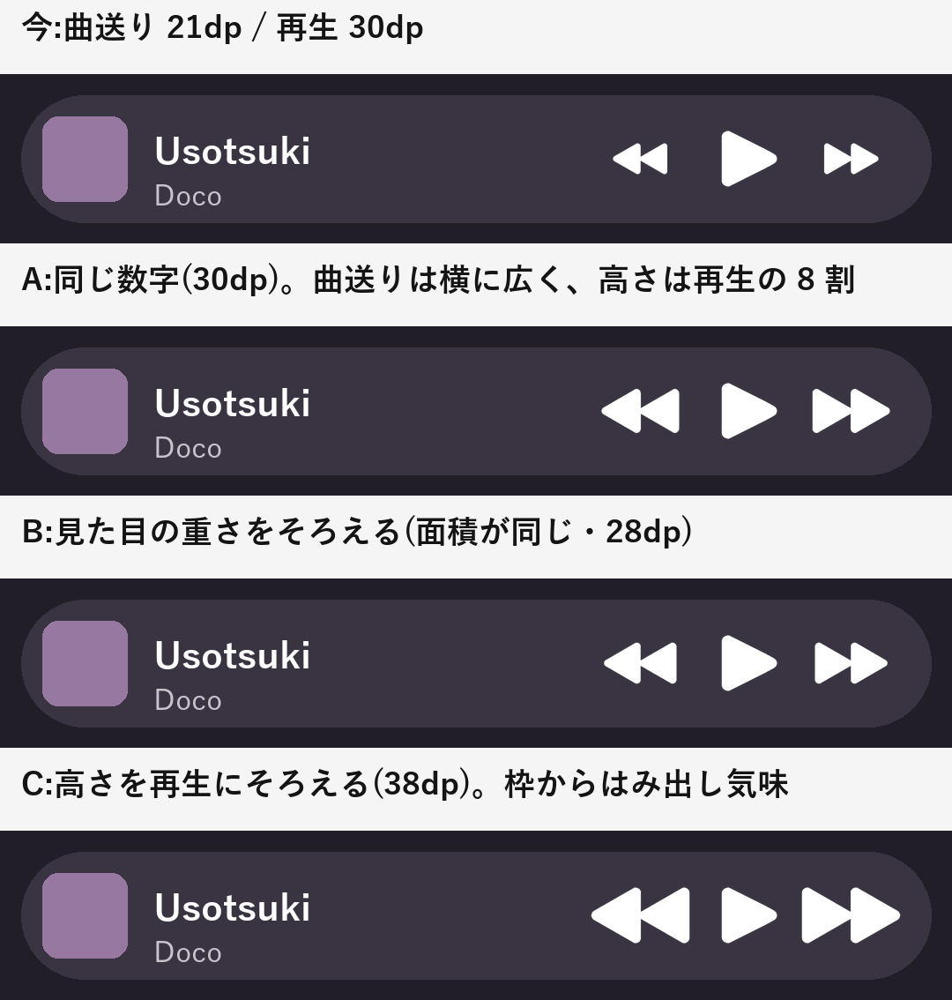

# ミニプレーヤーの曲送りの大きさ・歌詞のタップ — Implementation plan

## 要望
1. ミニプレーヤーの曲送り・曲戻しボタンを、再生・一時停止ボタンと同じ大きさにしたい。
2. 歌詞をタップして前の時間に戻ろうとしても、タップがうまくいかない。

---

## Ch1. ミニプレーヤーの曲送り・曲戻しの大きさ

### 今の作り
- ミニプレーヤーは 2 か所ある。どちらも同じ大きさ。
  - ふつうのミニプレーヤー(ページの下に浮かぶもの)
  - ボトムバーにまとまったミニプレーヤー(バーを縮めたときなど)
- アイコンの大きさ:曲送り・曲戻し **21dp**、再生・一時停止 **30dp**。ボタンの押せる範囲はどれも 40dp。
- 再生画面の比率(曲送り 46 : 再生 66 ≒ 0.7)に合わせて、わざと小さくしてある。

### 「同じ大きさ」の取り方

曲送りのアイコンは横長(三角 2 つ)、再生は縦横がほぼ同じなので、同じ数字にしても見た目の大きさはそろわない。

| 案 | 曲送りのアイコン | 見え方 |
|---|---|---|
| A | 30dp(再生と同じ数字) | 曲送りは横に広く、高さは再生の約 8 割 |
| B | 28dp | 見た目の重さ(塗られた面積)が再生とおよそ同じ |
| C | 38dp | 高さが再生と同じ。横幅が押せる範囲(40dp)いっぱいで、詰まって見える |

### 決めてほしいこと
- **BQ: 曲送り・曲戻しの大きさ**
  - **推奨:A(30dp)。** 「同じ大きさ」に一番素直で、枠にも収まる。
  - 代替:B(28dp)/ C(38dp)
- 2 か所のミニプレーヤーの両方を同じにする。再生画面のボタンは変えない。

---

## Ch2. 歌詞のタップで前に戻れない

### 調べて分かったこと(原因の候補)
1. **戻る前に、歌詞が勝手に今の行へ戻ってしまう。**
   - 歌詞は、今の行が一番上に来るように自動でスクロールしている。前の行は画面の上に隠れているので、タップするには、まず指で上へスクロールする。
   - スクロールして指を離したとき、今の行がまだ画面に見えていると、**0.6 秒後に自動で今の行へ戻る** 作りになっている。
   - そのため、前の行を探してタップしようとした瞬間に、行が指の下から動いてしまう。**一番大きい原因と考えている。**
   - (今の行が画面から外れるまでスクロールした場合は、5 秒後に戻る。)
2. **スクロールが止まりきる前のタップが、止めるだけで終わる。**
   - 指で弾いたスクロールや自動スクロールが動いている最中に触ると、最初のタップはスクロールを止めるのに使われ、行のタップにならないことがある。実機で確かめる。
3. **タップしてから歌詞が動くまでに間がある。**
   - タップで再生位置は移るが、歌詞の表示は、次に再生位置を受け取るまで元の時間のまま進む。少し遅れて動くので、効かなかったように見えることがある。

### 変更
1. **指が触れている間と、離してからしばらくは、自動で戻さない。**
   - 0.6 秒で戻すのをやめ、最後に触ってから 3 秒たったら戻す(今の行が見えていても見えていなくても同じ)。
   - 歌詞に指が触れた時点で、その 3 秒を数え直す(スクロールしていない、ただ触っただけでも)。
2. **タップしたら、すぐにその行へ動く。**
   - タップした時点で、歌詞の表示の時間をその行の時間に合わせ、自動スクロールに戻す。再生位置の更新を待たない。
3. **スクロール中のタップも、行のタップとして受け取る。**
   - 2 の原因が実機で確かめられたら、行のタップの受け取り方を、スクロール中でも効く形に変える(スクロールを止めつつ、その行へ移る)。
- 対象:歌詞の表示はどれも同じ部品なので、再生画面の歌詞・アートワーク部分の歌詞・2 カラムの右の列・横向きの再生画面の歌詞のすべてに効く。

### 決めてほしいこと
- **BR: 自動で今の行へ戻すまでの時間**
  - **推奨:最後に触ってから 3 秒**
  - 代替:5 秒 / 戻さない(再生画面を開き直すまで、スクロールした位置のまま)

---

## 決めてほしいことのまとめ
| # | 論点 | 推奨 | 代替 |
|---|---|---|---|
| **BQ** | ミニプレーヤーの曲送り・曲戻しの大きさ | **A:30dp(再生と同じ数字)** | B:28dp / C:38dp |
| **BR** | 歌詞を自動で今の行へ戻すまで | **最後に触ってから 3 秒** | 5 秒 / 戻さない |

## 対象ファイル(見込み)
| ファイル | 内容 |
|---|---|
| `ui/components/MiniPlayer.kt` | 曲送り・曲戻しのアイコンの大きさ |
| `ui/components/GlassNavBar.kt` | ボトムバーのミニプレーヤーの同じ部分 |
| `ui/player/NowPlayingScreen.kt`(歌詞の部分) | 自動で戻す時間、触っている間は戻さない、タップしたらすぐ移る、スクロール中のタップ |

## 確認方法(Vivo)
- ミニプレーヤー(2 か所)で、曲送り・曲戻しが再生と同じ大きさに見えること。押せる範囲が変わっていないこと。
- 歌詞:上にスクロールして前の行をタップすると、その行へ戻ること。スクロールの途中で行が勝手に動かないこと。弾いたスクロールの途中でタップしても戻れること。タップしてすぐ歌詞が動くこと。3 秒触らなければ今の行へ戻ること。
- ビルドして `release_apk\<version>_<内容>\` に置く。
