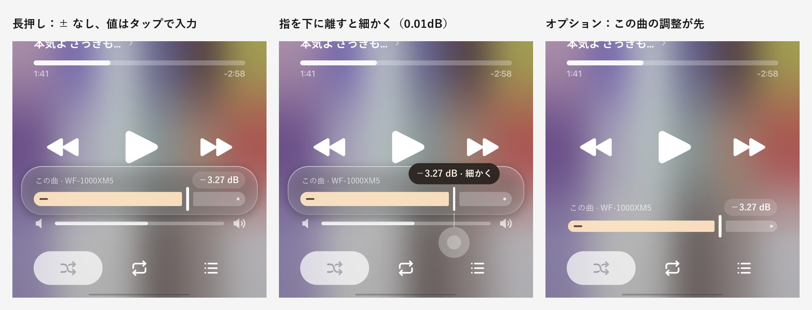

# 曲ごとのマイナスゲインと「下げるだけ」の音量そろえ — 構想のまとめ

## 背景
- OS の音量は段階が粗く(15〜25 段くらい)、細かく合わせられない。
- 今の ReplayGain は、小さい曲を上げる(ブーストする)ので音割れするか、音割れを防ぐと基準まで届かずそろわない。それに、標準の基準(−18 LUFS)だと今の曲はほとんど 6〜10dB 下がり、全体がかなり小さくなる。

この 2 つを、**音を上げる方向を使わずに(マイナスだけで)** 解決する。

---

## 1. 曲ごと・機器ごとのマイナスゲイン(手で合わせる)

### 中身
- プリアンプのように、その曲だけにかかるマイナスのゲインをつけられる。
- **「つないでいる機器 × 曲」ごとに保存する。** 同じ曲でも、イヤホンとスピーカーで別の値にできる。
- 機能そのもののオン・オフを設定で選べる。オフのときは、保存した値を使わない(消さない)。
- 値は 0.01dB 単位で保存・適用する。

### UI(おすすめ)
- 再生画面の音量バーは 1 本のまま(OS の音量)。
- **音量バーを長押し** → 音量バーのすぐ上に、「この曲の調整」バーの入った **Liquid Glass のポップアップ** が浮かぶ(⋯ ボタンのメニューと同じガラス)。音量バーは動かない。
  - 範囲は 0 〜 −12dB(範囲は要検討)。0 の位置で軽く止まる。
  - **ドラッグ:** 0.1dB 刻み。ドラッグ中に指をバーから下に離すと 0.01dB 刻みになる(吹き出しに「細かく」と出る)。
  - **値をタップ:** 右上の「−3.27 dB」(薄いカプセル)をタップすると、0.01dB 単位で数字を入力できる。
  - ± ボタンは置かない。その分バーを左右いっぱいに広げる。
  - バーの上に「この曲 · 機器名」と値を出す。
  - 数秒触らなければ引っ込む。ポップアップの外をタップしても閉じる。
- 調整が入っている曲は、音量バーの端に「−3.27dB」のような小さな印を出す。印をタップで開く、長押しで 0 に戻す。
- 1 本にまとめる案(曲が変わるたびにバーが動いて紛らわしい)と、2 本並べる案(画面がうるさく、たまにしか触らない)は採らない。
- **オプション:「この曲の調整」を先に出す。** 設定で入れ替えると、ふだんは「この曲の調整」バーが音量バーの位置にあり、長押しで端末の音量バーが同じガラスのポップアップで出る。OS の音量は最大のまま、音量はこのバーで決める、という使い方向け。

- 見た目(mock):Material 3 Expressive のスライダー
  - 太いトラック(ポップアップ内 20dp、音量バーの位置に置くとき 16dp)を、縦の細い取っ手の前後ですき間を空けて分ける。外側の端は大きく丸く、取っ手側は角を小さく。
  - 右端(0dB)に小さな点。塗られた側の左端に「−」のアイコン。
  - ドラッグ中だけ、取っ手の上に値の吹き出し。
  - 色は M3 のテーマ色ではなく、塗りは暖かいクリーム色、残りは半透明の白、取っ手は白(アートから作る背景の上で浮かないように)。
  - ポップアップの中の「端末の音量」バーは、今の細い音量バーの形のまま。

### 作り
- プレーヤーの音量では下げない(今のクロスフェードがプレーヤーの音量を動かしているのでぶつかる)。音の処理の中で、EQ の手前で下げる。
- マイナスだけなので、音割れの心配はない。
- 機器の見分け方は、EQ の「機器ごとのプリセット」と同じ。
- 端末の曲は、ファイルの場所が変わってもずれないように、曲名・アーティスト・長さで見分ける。

---

## 2. 「下げるだけ」の音量そろえ(自動で合わせる)

### 基準の決め方(機器ごと)
1. **OS の音量を最大にしてもらう。**
2. 曲を流しながら、アプリのスライダーで音量を下げていき、「ちょうどいい」と思ったところで止める。
   - OS の音量が最大なので、**スライダーは最初からマイナス側(例:−20dB)に置いておく。** いきなり大音量で鳴らないように、下げた状態から上げて合わせる。
3. これを、好きな曲で何曲か続ける。
4. 合わせた曲それぞれについて「その曲の大きさ + 止めた位置」を出し、その平均を **基準の大きさ** にする。これが「OS の音量が最大のときに、ちょうどいいと感じる大きさ」になる。
5. 基準は **つないでいる機器ごとに保存する**(イヤホンとスピーカーでは、ちょうどいい大きさが違うため)。

### 全体への反映
- 各曲の調整 = 基準の大きさ − その曲の大きさ。ただし **0dB より上にはしない。**
  - 基準より大きい曲 → その差だけ下げる。
  - 基準より小さい曲 → そのまま。

例(ある機器で、OS の音量を最大にして合わせたとき):

| 合わせた曲 | 曲の大きさ | 止めた位置 | ちょうどいい大きさ |
|---|---|---|---|
| A | −8 LUFS | −12dB | −20 |
| B | −14 LUFS | −5dB | −19 |
| | | 基準(平均) | **−19.5** |

その後、ほかの曲は:

| 曲 | 曲の大きさ | アプリの調整 | OS 最大で聴いたとき |
|---|---|---|---|
| C | −10 LUFS | −9.5dB | −19.5 |
| D | −18 LUFS | −1.5dB | −19.5 |
| E | −22 LUFS | 0dB(上げない) | −22(2.5dB 小さい) |

### 分かったこと
- 曲どうしの差は OS の音量に関係なく、どの音量でも同じようにそろう。OS の音量は全体を一緒に上げ下げするだけ。
- OS の音量を最大にして合わせるので、**「最大でちょうどいい」がそのまま基準になる。** 最大より下げれば、全体が一緒に小さくなる。細かい音量は、OS の段階の代わりにこのそろえ(と曲ごとの調整)で決まる。
- 基準より小さい曲(例の E)は、OS 最大でも基準まで届かない。ブーストしないので、ここは割り切る。合わせるときに「この基準だと、〇曲中△曲がそろいます」と出して判断できるようにする。
- 「OS の音量が最大のときだけかける」はやめる。最大の 1 つ手前から最大に上げた瞬間に、大きい曲だけが急に下がる(音量を上げたのに小さくなる)ため。合わせるときだけ最大にして、結果はいつもかける。

### 設定画面
- EQ の画面に「音量の基準を合わせる」を置く(機器ごと。今つないでいる機器の名前を出す)。
- 開くと:
  1. 「OS の音量を最大にしてください」と出す。最大になるまで先へ進めない(スライダーを −20dB にしてから最大にする)。
  2. 今の曲(または選んだ曲)が流れ、スライダーで合わせる。0.1dB 刻み、− / ＋ で 0.01dB。
  3. 「この曲で決める」→「次の曲」で何曲か続ける。合わせた曲の一覧と、それぞれの位置を出す。
  4. 「完了」で基準を保存。「〇曲中△曲がそろいます」も出す。
- やり直し・基準の削除もできる。

### 使える今の仕組み
- **ReplayGain のタグ:** 曲にタグがあればその値から大きさが分かる。
- **アプリの音量測定:** 端末の曲を実際に測ってラウドネスを出す機能がすでにある(結果はアプリ内に保存)。
- **YouTube Music の曲:** 配信の情報に音の大きさ(loudnessDb)が含まれていて、すでに読み取っている。

---

## 2 つを合わせたとき
- 最終的なゲイン = 「下げるだけ」のそろえ + 曲ごと・機器ごとの調整。どちらもマイナスなので、合計もいつもマイナス。音割れは起きない。
- どちらも機器ごとに保存されるので、機器をつなぎ替えると両方が切り替わる。
- **曲ごとの調整は「そろえた後の大きさ」からの差にする(案)。** そろえが有効なとき、バーの 0 の位置は「そろえた大きさ」。
  - 下げる方向:−12dB まで(今と同じ)。
  - 上げる方向:そろえで下げた分までなら戻せる。合計(そろえ + 調整)は 0dB を超えない。例:そろえで −9.50dB 下がった曲は、最大 +9.50dB まで戻せる。
  - ポップアップの値は「−7.50 dB(そろえ −9.50 / 調整 +2.00)」のように両方を出す。
  - 2 つの値は別々に保存するので、基準を合わせ直しても、曲ごとの調整の意味(そろえた大きさからの差)は変わらない。
  - 曲ごとの調整は、**そろえが有効なときと無効なときで別々に保存する。** 同じ「−2dB」でも、有効なら「そろえた大きさから −2」、無効なら「元の大きさから −2」で意味が違うため。切り替えると、それぞれのときに合わせた値に戻る。
- **合わせたあとは、OS の音量を最大にしても基準より大きくはならない。** そこで、**そろえ全体のマイナスを一括でゆるめられる「全体の大きさ」を持つ(機器ごと)。**
  - 「全体の大きさ」を +X dB にすると、基準が X dB 上がり、全曲の下げ幅が X dB ずつ小さくなる。
  - 下げ幅が 0 を下回る(ブーストが必要になる)曲は 0dB で止める。
  - OS 最大で合わせると、ほとんどの曲はもともとかなり下げられているので、上げる余地は大きい。
  - 代わりに、上げるほど 0dB で止まる曲が増え、小さい曲とのそろい方はゆるくなる。いちばん上まで上げると、そろえを止めたのと同じになる。
  - 「そろえを一時的に止める」「機器ごとに基準を 2 つ持つ」は、これで代わりになるので要らない。
  - 置き場所:**設定(EQ の画面、基準を合わせる項目の近く)だけ。** 再生画面には出さない。長押しのポップアップは「この曲」だけのまま。
  - 範囲:**0 〜 +15dB で固定**(0.01dB 単位)。曲が増えても目盛りは変わらない。
  - スライダーの上に「ここから上は、そろえなしと同じ」の印を出す。位置は、今わかっている曲のうち一番大きい下げ幅。
  - スライダーの下に、**今の上げ幅で 0dB に止まっている(そろっていない)曲の数**を出す。例:「+4.00dB:312 曲がそろえの外(0dB)」。
  - 「詳細」をタップすると、その曲の一覧を出す。曲名・アーティストと、本来ほしい下げ幅(どれだけ足りないか)を並べ、足りない順に並べる。
- そろえで大まかに合わせ、気になる曲だけ手で詰める、という使い方になる。

---

## まだ決めていないこと
| # | 論点 | 今の考え |
|---|---|---|
| **BF** | 曲ごとの調整の範囲 | 0 〜 −12dB |
| **BG** | 「下げるだけ」を今の ReplayGain とどう並べるか | ReplayGain の中の「そろえ方」として、「標準 / 下げるだけ」を選べるようにする |
| **BH** | 大きさが分からない曲(タグなし・未測定) | 再生するときにその場で測るか、測るまで 0dB にするか |
| **BI** | アルバム単位でそろえるか | 今の ReplayGain のアルバムモードと同じく、選べるようにする |
| **BJ** | 曲ごとの調整を、機器ごとでなく全機器共通にもできるか | 機器ごとを基本にし、「全機器に同じ値」を選べるか検討 |
| **BK** | 設定の置き場所 | EQ の画面(今の ReplayGain の近く) |
| **BL** | 基準を合わせるスライダーの範囲と最初の位置 | −40 〜 0dB、最初は −20dB |
| **BM** | 基準をまだ合わせていない機器 | そろえをかけない(0dB) |
| ~~BO~~ | 「全体の大きさ」の置き場所 | **決定:設定(EQ の画面)だけ** |
| ~~BP~~ | 「全体の大きさ」の範囲 | **決定:0 〜 +15dB 固定。「そろえなしと同じ」の印、0dB に止まっている曲数と一覧** |
| **BN** | 「この曲の調整」を先に出すオプションの置き場所 | 曲ごとの調整のオン・オフのすぐ下 |
