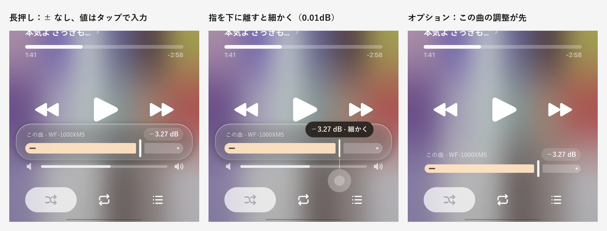

# 曲ごとの調整と「下げるだけ」の音量そろえ — Implementation plan

構想のまとめ:[2026-11-01-per-song-gain-and-attenuate-only-normalization.md](2026-11-01-per-song-gain-and-attenuate-only-normalization.md)

## 要望
1. OS の音量は段階が粗く、細かく合わせられない。プリアンプのように、その曲だけにかかるマイナスのゲインをつけたい。つないだ機器ごと・曲ごとに保存する。機能のオン・オフは選べる。
2. 今の ReplayGain は小さい曲を上げる(ブーストする)のが問題。ブーストせず、下げるだけで音量をそろえたい。基準は、OS の音量を最大にして、何曲かを「ちょうどいい」ところまで下げて決める。機器ごとに保存する。

どちらも **音を下げる方向だけ** を使う。合計がいつも 0dB 以下なので、音割れは起きない。

---

## Ch1. 土台:かけるゲインの組み立て

### 今の作り
- 音の処理は「リサンプラー → パラメトリック EQ → 空間オーディオ → ReplayGain」の順。ReplayGain は最後の段で、曲ごとに値を変えられる。
- クロスフェードはプレーヤーの音量を動かしている。ReplayGain の段は音量と別なので、ぶつからない。
- ReplayGain は今、端末の曲にだけかかる(YouTube Music の曲にはかからない)。

### 変更
- 最後の段(今の ReplayGain の段)でかける値を、次の合計にする。

```
かける値 = そろえ(標準の ReplayGain か、下げるだけのそろえ)+ 曲ごとの調整
```

- 「下げるだけ」のときは、合計が 0dB を超えないように止める。
- 曲が切り替わるとき・機器をつなぎ替えたとき・設定を変えたときに計算し直す(今の ReplayGain と同じ仕組みに乗せる)。

### 保存の単位
| 値 | 単位 |
|---|---|
| 曲ごとの調整 | 機器 × 曲 × (そろえ有効 / 無効) |
| 基準の大きさ | 機器 |
| 全体の大きさ | 機器 |

- **機器** の見分け方は、EQ の「機器ごとのプリセット」と同じ(今つながっている出力機器)。
- **曲** の見分け方:
  - 端末の曲:曲名・アーティスト・長さ(秒)を正規化したもの。ファイルの場所が変わってもずれない。
  - YouTube Music の曲:動画 ID。

### 曲の大きさ(ラウドネス)の取り方
| 曲 | 取り方 |
|---|---|
| 端末の曲(ReplayGain のタグあり) | タグの値から逆算(ReplayGain 2.0 の基準 −18 LUFS からの差として扱う) |
| 端末の曲(タグなし) | アプリの音量測定の結果(すでにアプリ内に保存されている) |
| YouTube Music の曲 | 配信の情報にある音の大きさ(loudnessDb)から換算 |

- YouTube Music の換算方法(loudnessDb と LUFS の関係)は、実装のときに何曲か実測して合わせる。

---

## Ch2. 曲ごとの調整



### 再生画面
- 音量バーは 1 本のまま(OS の音量)。
- **音量バーを長押し** すると、音量バーのすぐ上に **Liquid Glass のポップアップ** が浮かぶ(⋯ メニューと同じガラス)。音量バーは動かない。
- ポップアップの中:
  - 上に「この曲 · 機器名」と、値のカプセル(例:−3.27 dB)。
  - **Material 3 Expressive のスライダー**:太いトラック(20dp)を縦の細い取っ手の前後で分ける。右端(0dB)に点、塗られた側に「−」のアイコン。色は塗りがクリーム色、残りが半透明の白、取っ手が白。
  - ドラッグは 0.1dB 刻み。**指をバーから下に離すと 0.01dB 刻み** になり、吹き出しに「細かく」と出る。
  - **値のカプセルをタップ** すると、0.01dB 単位で数字を入力できる。
  - ± ボタンは置かない。
  - 数秒触らないか、外をタップすると閉じる。
- 調整が入っている曲は、音量バーの右上に「−3.27 dB」の小さな印を出す。印をタップでポップアップが開く。長押しで 0 に戻す。

### そろえが有効なとき
- バーの 0 は「そろえた大きさ」。
- 下げる方向は −12dB まで。上げる方向は **そろえで下げた分まで** 戻せる(合計は 0dB を超えない)。
- 値は「−7.50 dB(そろえ −9.50 / 調整 +2.00)」のように両方出す。
- そろえ有効のときの値と、無効のときの値は別々に保存する。

### オプション:「この曲の調整」を先に出す
- 設定の再生画面の欄で入れ替えると、音量バーの位置に「この曲の調整」バー(16dp のトラック)が来て、長押しで「端末の音量」バー(今の細い形)が同じガラスのポップアップで出る。

### 設定
- **EQ の画面**:「曲ごとの調整」のオン・オフ。オフのときは、保存した値を使わない(消さない)。ポップアップも印も出ない。
- **設定の再生画面の欄**:「この曲の調整を先に出す」。

---

## Ch3. 音量バーの触り方

### 問題
- 今の音量バーは、触れた瞬間に指の位置へ値が飛ぶ。長押しのつもりで指を置いただけで、音量が変わってしまう。

### 変更(音量バーと「この曲の調整」バーの両方)
1. 触れただけでは値を変えない。指を動かした分だけ値が動く(iPhone の音量バーと同じ)。
2. 指が横に 8dp ほど動くまでは値を変えない(手の震えで動かないように)。
3. 指をほぼ動かさず 0.4 秒置いたら長押し。軽く振動し、ポップアップを出す。それまでに横に動いたら、ふつうの操作になる。
4. ポップアップが出たら、指を離さずに横へ動かすと、ポップアップのバーが動く(長押しから微調整までひと続き)。

---

## Ch4. 「下げるだけ」の音量そろえ

### 置き場所
- **EQ の画面**、今の ReplayGain の項目の中。「そろえ方」を **標準 / 下げるだけ** から選ぶ。
  - 標準:今の ReplayGain(プリアンプ・音割れを防ぐ・アルバムモードもそのまま)。
  - 下げるだけ:以下。

### 基準を合わせる(機器ごと)
「音量の基準を合わせる」を開くと:
1. 「OS の音量を最大にしてください」と出す。スライダーを −20dB にしてから最大にするボタンも置く(いきなり大音量にならないように)。最大になるまで先へ進めない。
2. 今の曲(または選んだ曲)が流れ、スライダー(−40 〜 0dB、最初は −20dB)で「ちょうどいい」ところまで合わせる。スライダーは Ch2 と同じ M3 Expressive の形、同じ触り方(細かく・数値入力)。
3. 「この曲で決める」→「次の曲」で何曲か続ける。合わせた曲の一覧と、それぞれの位置を出す。
4. 「完了」で、各曲の「曲の大きさ + 止めた位置」の平均を **基準の大きさ** として保存する。
- やり直し・基準の削除もできる。
- **基準をまだ合わせていない機器では、そろえをかけない**(0dB)。

### 全体への反映
- 各曲のそろえ = 基準の大きさ + 全体の大きさ − その曲の大きさ。**0dB より上にはしない。**
- 曲の大きさがまだ分からない曲:再生したときに裏で測り、**次に再生したときから** かける(途中で音量が変わらないように)。それまでは 0dB。今の「全曲を測る」機能もそのまま使える。

### 全体の大きさ(機器ごと)
- 基準を合わせる項目の下に置く。**設定だけ**(再生画面には出さない)。
- 範囲は **0 〜 +15dB で固定**(0.01dB 単位)。上げるほど全曲の下げ幅が小さくなる。0dB に届いた曲はそこで止まる。
- スライダーの上に「ここから上は、そろえなしと同じ」の印(今わかっている曲で一番大きい下げ幅の位置)。
- スライダーの下に「+4.00dB:312 曲がそろえの外(0dB)」のように、0dB に止まっている曲の数。
- 「詳細」で、その曲の一覧(曲名・アーティスト・そろえるにはあと何 dB 足りないか)。足りない順。
- まだ大きさが分からない曲の数も出す(「未測定:〇曲」)。

---

## 決めてほしいこと
| # | 論点 | 推奨 | 代替 |
|---|---|---|---|
| **BF** | 曲ごとの調整の下げる範囲 | **−12dB まで** | −20dB まで |
| **BG** | 「下げるだけ」と今の ReplayGain の並べ方 | **ReplayGain の中で「そろえ方:標準 / 下げるだけ」** | 別の項目として並べる |
| **BH** | 大きさが分からない曲 | **再生時に裏で測り、次の再生からかける** | 測るまで 0dB のまま(測るのは「全曲を測る」だけ) |
| **BI** | アルバム単位でそろえるか | **まずは曲単位だけ** | 標準と同じくアルバムモードも選べる |
| **BJ** | 曲ごとの調整を全機器共通にもできるか | **機器ごとだけ** | 「全機器に同じ値」を選べる |
| **BL** | 基準合わせのスライダー | **−40 〜 0dB、最初は −20dB** | −30 〜 0dB |
| **BN** | YouTube Music の曲もそろえるか | **そろえる(loudnessDb から換算)** | 端末の曲だけ |

決まっていること:置き場所は EQ の画面(「この曲の調整を先に出す」だけ設定の再生画面の欄)。全体の大きさは設定だけ、0 〜 +15dB 固定。基準を合わせていない機器ではそろえない。

---

## 対象ファイル(見込み)
| ファイル | 内容 |
|---|---|
| `playback/PlaybackService.kt` | かける値の組み立て(そろえ + 曲ごとの調整)、機器・曲が変わったときの計算し直し、YouTube Music の曲への適用 |
| `playback/ReplayGainAudioProcessor.kt` | 合計の値をかける(今のまま使える見込み。範囲の確認) |
| `playback/` 新規(ラウドネスの取得・そろえの計算) | タグ・測定結果・loudnessDb から曲の大きさを出す。下げるだけの計算 |
| `data/settings/` 新規(曲ごとの調整・基準の保存) | 機器 × 曲 × 有効/無効の値、機器ごとの基準と全体の大きさ |
| `data/settings/AppSettings.kt` | 機能のオン・オフ、そろえ方、この曲の調整を先に出す |
| `ui/player/NowPlayingScreen.kt` | 長押しのポップアップ、印、オプションの入れ替え |
| `ui/player/ThinSlider.kt` | 触り方の変更(相対ドラッグ・遊び・長押し) |
| `ui/player/` 新規(M3 Expressive のスライダー) | 太いトラック・取っ手・吹き出し・細かく・数値入力 |
| `ui/screens/equalizer/` | そろえ方の選択、基準合わせの画面、全体の大きさ、曲数と一覧、曲ごとの調整のオン・オフ |
| `ui/screens/SettingsSheet.kt` | 「この曲の調整を先に出す」 |
| `res/values*/strings.xml` | 文言(日本語・英語) |

## 確認方法
- 曲ごとの調整:音量バーの長押しでポップアップが出ること、長押しで音量が動かないこと、指を下に離すと 0.01dB で動くこと、数値入力、印、0 に戻す。機器を替えると値が切り替わること。オフで何も出ないこと。
- 音:調整した dB の通りに下がっていること(同じ曲を調整あり・なしで録って比べる)。クロスフェード中に音量が跳ねないこと。
- 下げるだけ:基準合わせの流れ、基準の保存(機器ごと)、全曲の下げ幅、0dB で止まること、全体の大きさで曲数が変わること、一覧。未測定の曲が次の再生からそろうこと。
- そろえ有効・無効で曲ごとの調整が別々に残ること。
- ビルドして `release_apk\<version>_<内容>\` に置く。Vivo で確認。
